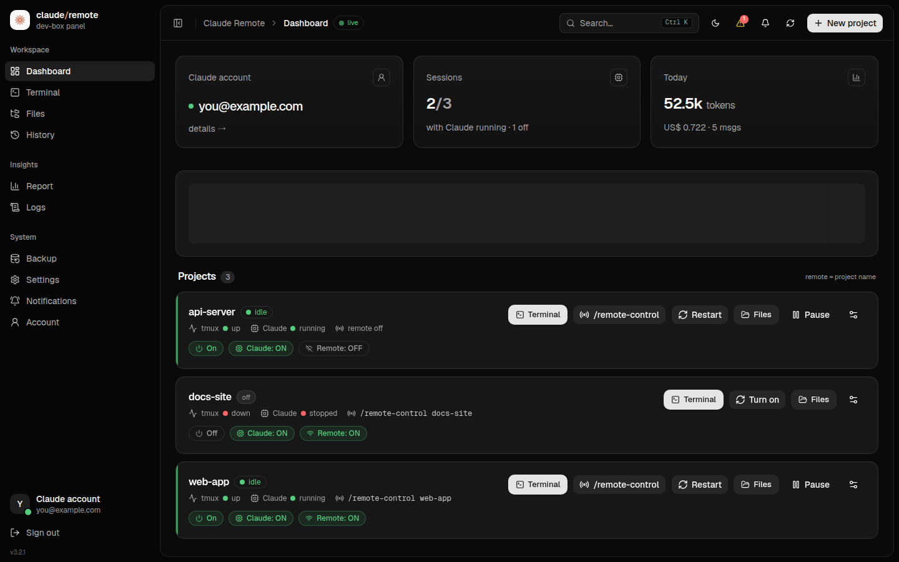
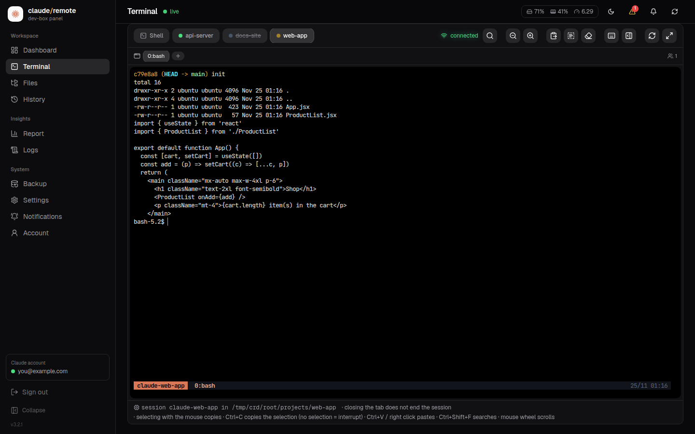
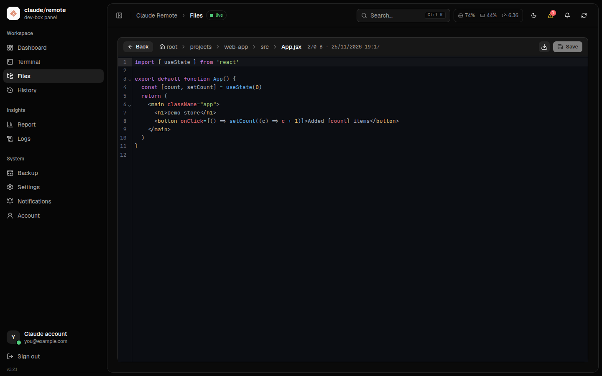
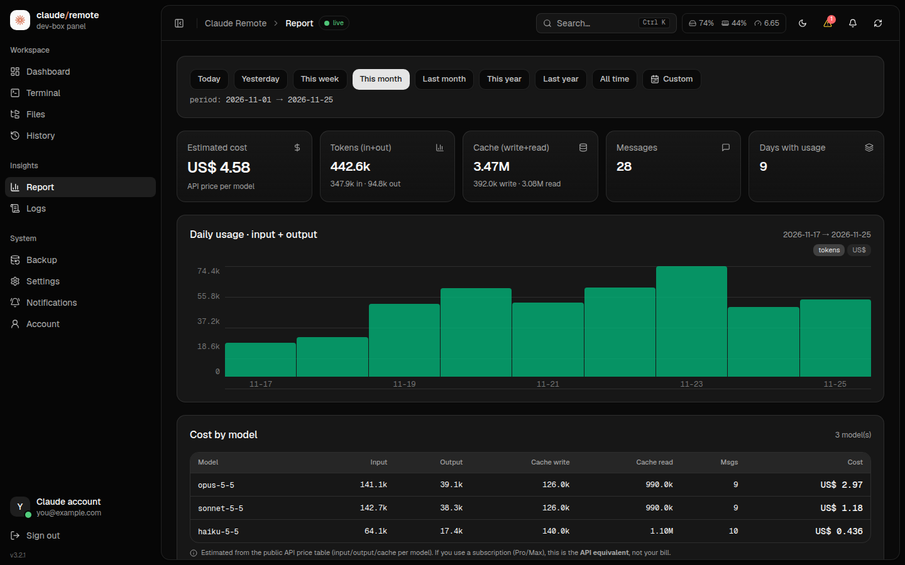
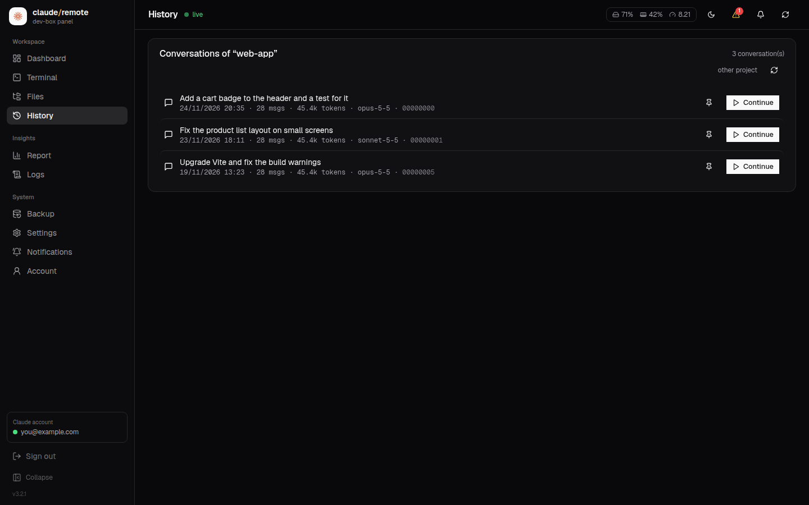
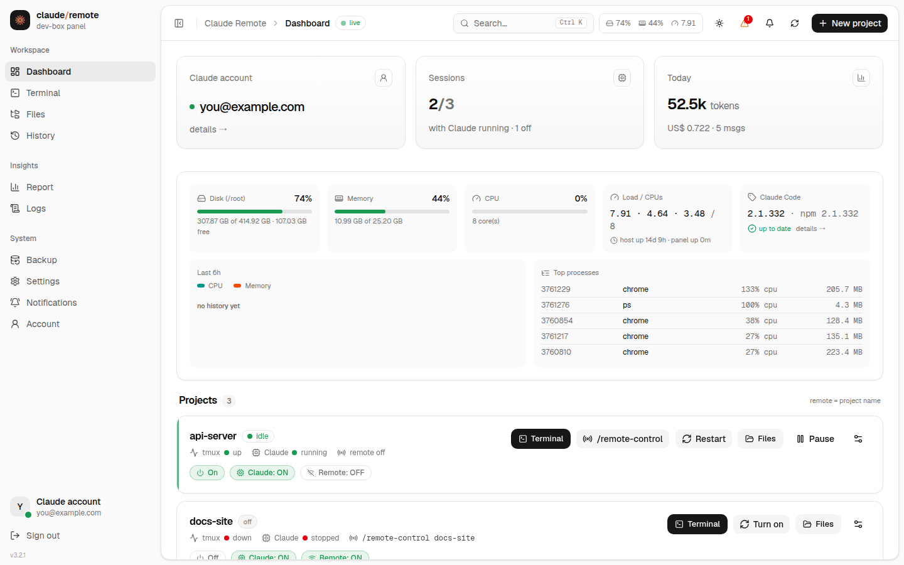
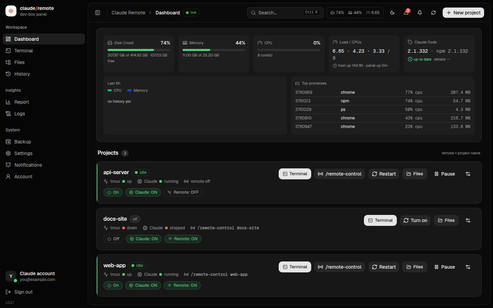
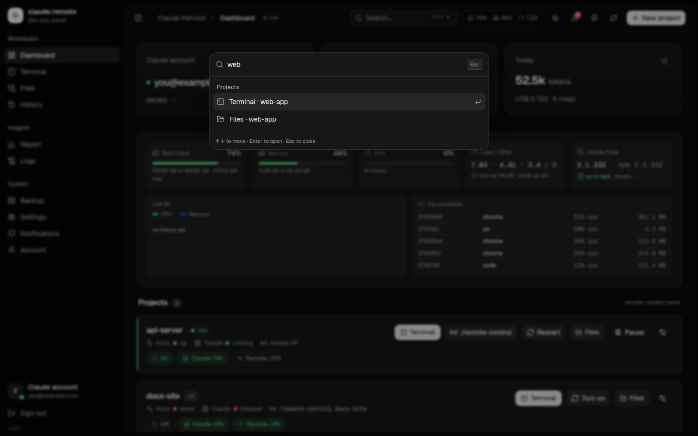
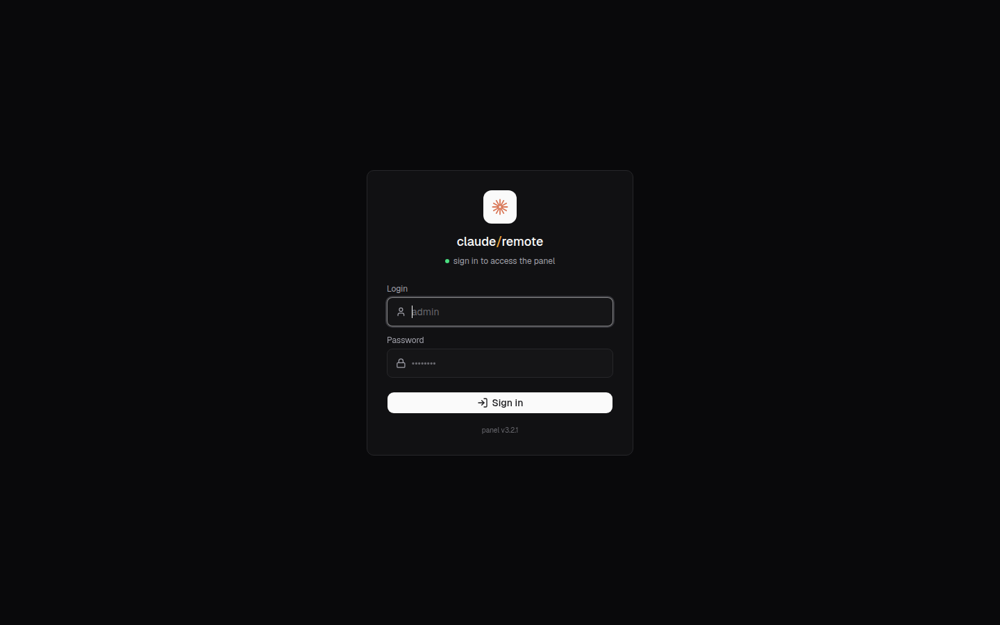
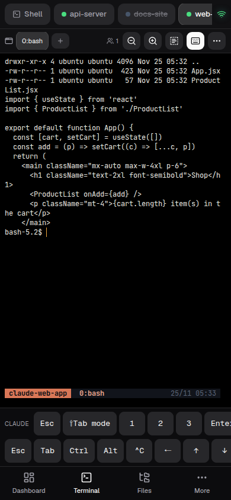

# Claude Remote

**Run Claude Code on your own server and drive it from any browser — desktop or phone.**

A single Docker container with Ubuntu, [Claude Code](https://docs.anthropic.com/en/docs/claude-code),
Playwright and a full dev toolchain, plus a web panel to manage your projects: a real terminal,
a file editor, conversation history, usage limits, cost reports and push notifications.
Your projects and your Claude login live in a volume, so nothing is lost on rebuilds.

🇧🇷 [Leia em português](README.pt-BR.md)



## Features

- **One tmux session per project** that never closes. Claude keeps working when you close the tab,
  lose the connection or switch devices. A supervisor reopens Claude if it exits, with crash-loop
  protection.
- **Real terminal in the browser:** xterm.js ↔ WebSocket ↔ PTY ↔ `tmux attach`. Colors, mouse,
  search, PuTTY-style copy/paste, reconnect, split view with the file browser.
- **Works on the phone:** installable PWA, a key bar (Esc, Tab, Ctrl, arrows, Claude shortcuts),
  bottom navigation and **Web Push** notifications ("Claude finished", "Claude is waiting for you",
  login needed, usage limit, crash loop).
- **Continues by itself after the usage limit:** when a project hits the plan limit, the panel waits
  for the reset and types `continue` in that session, only if nobody typed since and the screen is idle.
- **Updates without cutting work:** tasks interrupted by a restart continue by themselves, and
  Settings → *Update the panel* (with `DEPLOY_WEBHOOK_URL`) can wait until every project is idle.
- **Claude Code stays up to date:** the panel checks npm every 6 hours and installs new versions
  (goes back to the old one if the new one does not run). A switch in Settings; `CLAUDE_AUTO_UPDATE=0` turns it off.
- **Disk use per project:** see how much each project and each agent work copy uses, and remove
  old copies safely (only those with no unsaved changes and nothing running inside).
- **Plan usage and API spend:** 5-hour and weekly windows with reset times, alerts at your thresholds,
  and the Admin API spend for the month.
- **Cost report:** tokens and estimated cost per day, per model and per project, read from Claude's
  own conversation files.
- **Conversation history:** browse past conversations and continue any of them (`claude --resume`).
- **File browser + editor** (CodeMirror), upload/download, create/rename/delete.
- **Automatic Claude login:** the panel answers the first-run screens for you; you only paste the code.
- **Backups:** periodic `git commit + push` of each project, plus daily snapshots of the Claude config,
  and optionally an incremental copy of the whole volume to another disk (`VOLUME_BACKUP_DIR`).
- **Secure by default:** own login with signed, revocable sessions, optional 2FA (TOTP), rate limit,
  CSRF/Origin checks, CSP, audit log. The panel refuses to start without a password.
- **Command palette** (Ctrl/⌘ + K): jump to any page, project terminal or files from the keyboard.
- **Light/dark theme** (shadcn/ui on Tailwind v4) and **multiple languages** (English and Português; adding one is copying a JSON file).
- **Any Docker host:** amd64 and arm64, plain `docker compose`, optional automatic HTTPS.

## Screenshots

| Terminal | Files |
|---|---|
|  |  |
| **Report** | **History** |
|  |  |
| **Light theme** | **Projects** |
|  |  |

| **Command palette (Ctrl/⌘ + K)** | **Login** |
|---|---|
|  |  |

<p align="center"></p>

## Quick start

```bash
git clone https://github.com/VictorDeziderio/claude-server-remote.git
cd claude-server-remote
cp .env.example .env          # set PANEL_LOGIN and PANEL_PASSWORD (required)
docker compose up -d --build
```

Open `http://localhost:8080`, sign in, then go to **Account → Connect Claude** to log in with your
Claude subscription (or set `ANTHROPIC_API_KEY`). Create a project on the Dashboard and open its terminal.

> **Exposing it on the internet:** the panel gives a shell on the server. Put it behind HTTPS:
> set `PANEL_DOMAIN` (automatic Let's Encrypt, publish ports 80/443), or use your own reverse proxy /
> VPN pointing to port `8080`. Turn on 2FA in **Account**.

Everything you keep must be inside `/root` (the volume): projects, the Claude login (`~/.claude`),
panel settings and backups. The rest of the image is rebuilt on each deploy.

## How it works

```
browser ──► Caddy gateway (:8080, optional HTTPS)
              └─► panel (Node, 127.0.0.1:7001): REST + SSE + WebSocket
                    ├─ tmux session "claude-<project>"  ◄─ claude-loop.sh (supervisor) ◄─ Claude Code
                    ├─ files, history, usage, backups, push
                    └─ Claude Code hooks (Stop, StopFailure, Notification…) → notifications / auto-resume
```

- **Projects** are folders in `/root/projects`. Per-project settings are in `/root/.claude/panel.json`
  (on/off, start Claude or only a shell, remote control, first line sent to Claude, session mode,
  pause after N idle hours). The supervisor rereads it each time Claude starts.
- **Respawn in three layers:** Claude exits → the loop reopens it (~3s); the tmux session disappears →
  the watchdog recreates it (~10s); the container dies → your Docker restart policy brings everything back.
- **Permissions:** Claude runs as a non-root user with `/etc/claude-code/managed-settings.json`
  (`bypassPermissions`, `/root` allowed). Edit that file if you want Claude to ask again.

## Configuration

All variables have defaults; only `PANEL_PASSWORD` is required. Full list with comments: [`.env.example`](.env.example).

| Variable | Default | What it does |
|---|---|---|
| `PANEL_LOGIN` / `PANEL_PASSWORD` | `admin` / — | panel login. Change the login too; the panel refuses to start without a password |
| `PANEL_DOMAIN` | — | public domain for automatic HTTPS |
| `TRUSTED_PROXIES` | — | reverse proxy IPs, so the real client IP is used |
| `GATEWAY_PORT` | `8080` | public port of the gateway |
| `PANEL_SESSION_DAYS` | `365` | panel session lifetime, renewed while the device uses the panel |
| `PROJECT_FOLDER` | `claude` | default project created on the first start |
| `GH_TOKEN` | — | GitHub token (repo scope): `gh` login + backup pushes |
| `BACKUP_ENABLED` / `BACKUP_INTERVAL` | `true` / `3600` | project backups (git commit + push) |
| `VOLUME_BACKUP_DIR` / `VOLUME_BACKUP_KEEP` | — / `7` | incremental daily copy of the volume to another disk (only what changed takes space) |
| `ANTHROPIC_ADMIN_KEY` / `ANTHROPIC_API_BUDGET_USD` | — | API spend card and budget alerts |
| `USAGE_POLL_INTERVAL` / `USAGE_THRESHOLDS` | `300` / `80,95` | plan usage checks and alert levels |
| `AUTO_RESUME` / `AUTO_RESUME_TEXT` | `1` / `continue` | continue by itself after the usage limit |
| `CLAUDE_AUTO_UPDATE` / `CLAUDE_UPDATE_HOURS` | `1` / `6` | automatic Claude Code update and how often it checks |
| `DEPLOY_WEBHOOK_URL` | — | your hosting's deploy hook: Settings → **Update the panel** ("when idle" waits for running tasks) |
| `MAX_FAST_FAILS` / `MAX_BACKOFF_S` | `6` / `60` | crash-loop protection of the supervisor |

Build arguments (`docker build --build-arg`): `CLAUDE_CODE_VERSION` (default: latest),
`PLAYWRIGHT_VERSION`, `PLAYWRIGHT_BROWSERS` (`chromium chrome`; on arm64 use `chromium`), `CADDY_VERSION`.

## Included tools

Claude Code · Playwright (Chromium/Chrome) · Node 22 · npm / pnpm / yarn / bun · git · GitHub CLI ·
ripgrep · fd · jq · tree · build-essential · Python 3 · psql · tmux · Caddy.

## Development

```bash
cd panel
npm install
npm run dev        # Vite on :5173, proxying /api and /ws to `node server.js` on :7001 (needs tmux)
npm run check && npm run build && npm test
cd .. && bash tests/claude-loop.test.sh && bash tests/gateway.test.sh && bash tests/backup-volume.test.sh && shellcheck -S error *.sh tests/*.sh
```

- Panel: React + Tailwind v4 + shadcn/ui + xterm.js + CodeMirror, built with Vite. Server: Node
  (`panel/server.js` + `panel/server/*.js`), runtime deps `ws` and `node-pty`.
- **Translations:** UI and server texts are keys in `panel/src/locales/<lang>.json`
  (`en.json` is the default and the fallback). To add a language, copy `en.json` to `<code>.json`
  and translate the values; the tests check that every language has the same keys and placeholders.
- Tests never call Anthropic: the usage API, Claude itself and push services are faked.
- CI runs shellcheck, the panel build, unit + smoke tests (with real tmux), the supervisor and
  gateway tests, a repo hygiene check and the Docker build.

## Contributing

Issues and pull requests are welcome. Please work on a branch, keep the tests green, and add a test
with every fix. New texts go into the locale files (at least `en.json` and `pt-BR.json`).

## License

[MIT](LICENSE)
