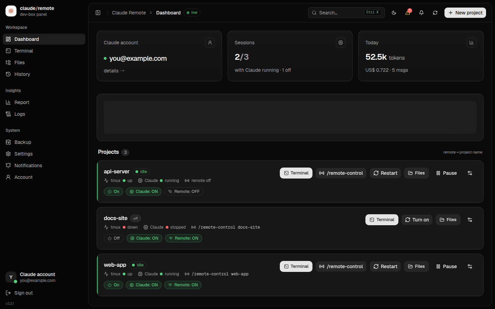
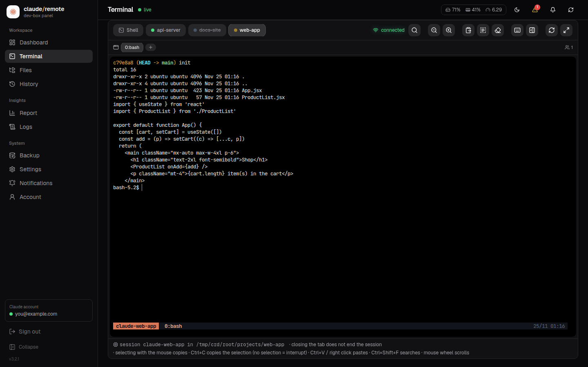
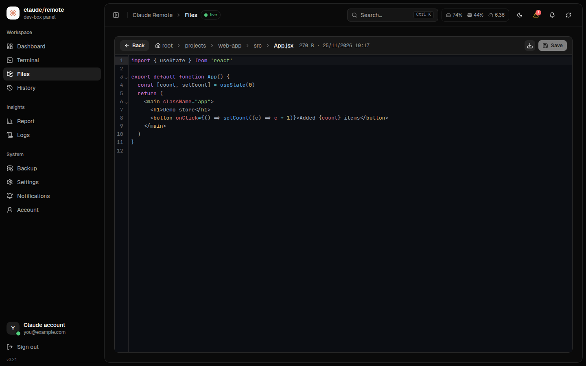
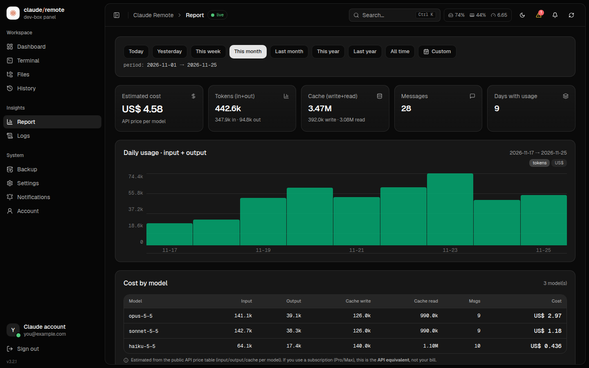
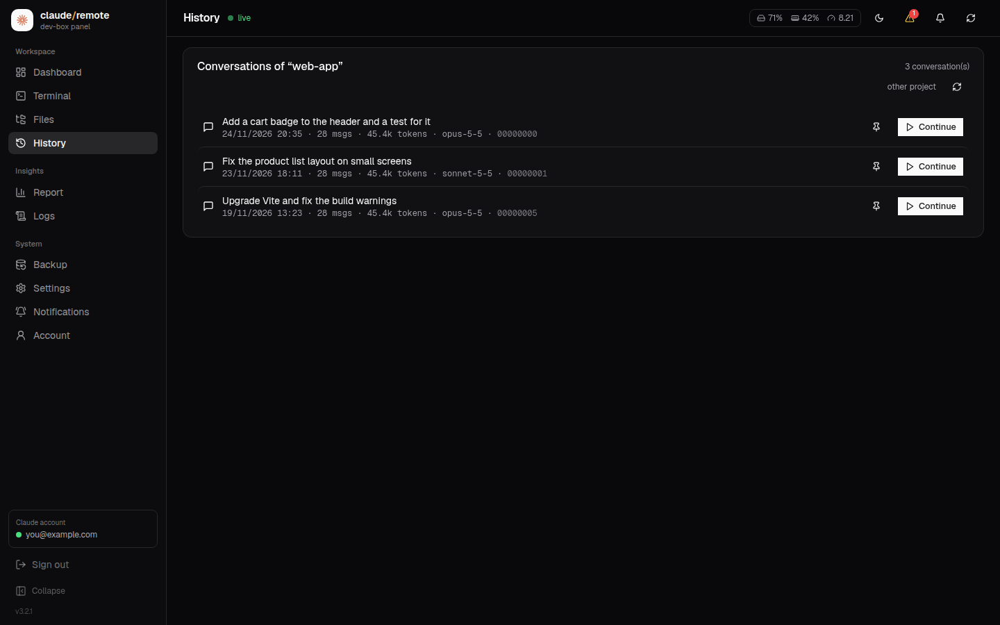
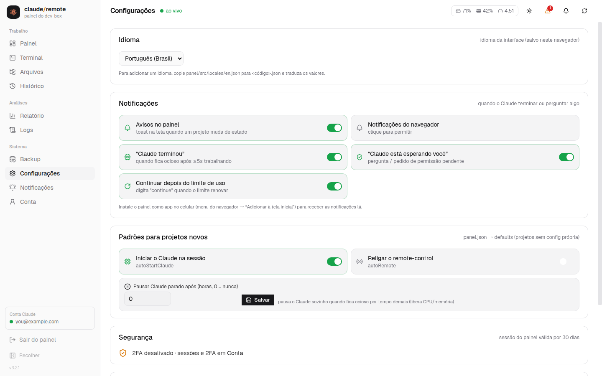
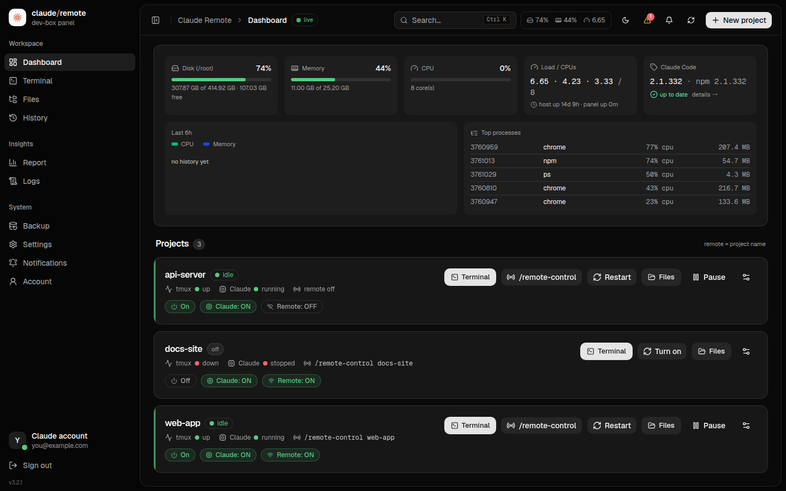
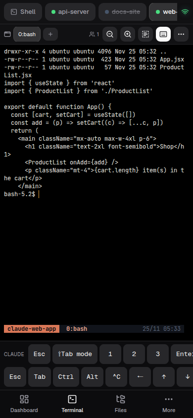

# Claude Remote

**Rode o Claude Code no seu próprio servidor e controle tudo pelo navegador — no computador ou no celular.**

Um único container Docker com Ubuntu, [Claude Code](https://docs.anthropic.com/en/docs/claude-code),
Playwright e ferramentas de desenvolvimento, mais um painel web para gerenciar os projetos: terminal
de verdade, editor de arquivos, histórico de conversas, limites de uso, relatório de custo e
notificações push. Os projetos e o login do Claude ficam num volume, então nada se perde ao recriar o container.

🇺🇸 [Read in English](README.md)



## Recursos

- **Uma sessão tmux por projeto**, que nunca fecha. O Claude continua trabalhando se você fechar a aba,
  perder a conexão ou trocar de aparelho. Um supervisor reabre o Claude se ele sair, com proteção
  contra reinícios em loop.
- **Terminal de verdade no navegador:** xterm.js ↔ WebSocket ↔ PTY ↔ `tmux attach`. Cores, mouse,
  busca, copiar/colar como no PuTTY, reconexão e tela dividida com os arquivos.
- **Funciona no celular:** instala como app (PWA), barra de teclas (Esc, Tab, Ctrl, setas, atalhos do
  Claude), menu embaixo e **notificações push** ("Claude terminou", "Claude está esperando você",
  login necessário, limite de uso, reinícios em loop).
- **Continua sozinho depois do limite de uso:** quando um projeto bate o limite do plano, o painel espera
  a renovação e digita `continue` na sessão — só se ninguém tiver digitado nada e a tela estiver parada.
- **Atualiza sem cortar o trabalho:** tarefas interrompidas por um reinício continuam sozinhas, e
  Configurações → *Atualizar o painel* (com `DEPLOY_WEBHOOK_URL`) pode esperar todos os projetos pararem.
- **Disco por projeto:** veja quanto cada projeto e cada cópia de trabalho dos agentes ocupa e remova
  as cópias antigas com segurança (só as sem mudanças não salvas e sem nada rodando dentro).
- **Uso do plano e gasto da API:** janelas de 5 horas e semanal com horário de renovação, alertas nos
  limiares que você escolher e o gasto do mês pela Admin API.
- **Relatório de custo:** tokens e custo estimado por dia, por modelo e por projeto, lidos das conversas do Claude.
- **Histórico de conversas:** veja conversas antigas e continue qualquer uma (`claude --resume`).
- **Arquivos + editor** (CodeMirror), upload/download, criar/renomear/excluir.
- **Login do Claude automático:** o painel responde as telas do primeiro uso; você só cola o código.
- **Backups:** `git commit + push` periódico de cada projeto, cópia diária da configuração do Claude e,
  se quiser, uma cópia incremental do volume inteiro em outro disco (`VOLUME_BACKUP_DIR`).
- **Seguro por padrão:** login próprio com sessões assinadas e revogáveis, 2FA (TOTP) opcional, limite de
  tentativas, checagem de origem (CSRF), CSP e registro de auditoria. Sem senha, o painel não sobe.
- **Tema claro/escuro** e **vários idiomas** (inglês e português; um idioma novo é só copiar um arquivo JSON).
- **Qualquer Docker:** amd64 e arm64, `docker compose` simples, HTTPS automático opcional.

## Telas

| Terminal | Arquivos |
|---|---|
|  |  |
| **Relatório** | **Histórico** |
|  |  |
| **Configurações em português (tema claro)** | **Projetos (com o "continua às…")** |
|  |  |

<p align="center"></p>

## Começo rápido

```bash
git clone https://github.com/VictorDeziderio/claude-server-remote.git
cd claude-server-remote
cp .env.example .env          # defina PANEL_LOGIN e PANEL_PASSWORD (obrigatória)
docker compose up -d --build
```

Abra `http://localhost:8080`, entre e vá em **Conta → Conectar o Claude** para logar com a sua
assinatura do Claude (ou defina `ANTHROPIC_API_KEY`). Crie um projeto no Painel e abra o terminal dele.
O idioma muda em **Configurações → Idioma**.

> **Na internet:** o painel dá acesso a um shell no servidor. Use HTTPS: defina `PANEL_DOMAIN`
> (Let's Encrypt automático, publique as portas 80/443) ou use o seu proxy reverso / VPN apontando
> para a porta `8080`. Ative o 2FA em **Conta**.

Tudo o que você quer guardar precisa estar dentro de `/root` (o volume): projetos, login do Claude
(`~/.claude`), configurações do painel e backups. O resto da imagem é recriado a cada deploy.

## Como funciona

```
navegador ──► gateway Caddy (:8080, HTTPS opcional)
                └─► painel (Node, 127.0.0.1:7001): REST + SSE + WebSocket
                      ├─ sessão tmux "claude-<projeto>"  ◄─ claude-loop.sh (supervisor) ◄─ Claude Code
                      ├─ arquivos, histórico, uso, backups, push
                      └─ hooks do Claude Code (Stop, StopFailure, Notification…) → avisos / continuar sozinho
```

- **Projetos** são pastas em `/root/projects`. As opções de cada projeto ficam em `/root/.claude/panel.json`
  (ligado/desligado, abrir o Claude ou só um shell, remote control, primeira linha enviada ao Claude,
  modo de sessão, pausar após N horas parado). O supervisor relê o arquivo sempre que abre o Claude.
- **Reabertura em três camadas:** o Claude sai → o loop reabre (~3 s); a sessão tmux some → o watchdog
  recria (~10 s); o container cai → a política de restart do Docker sobe tudo de novo.
- **Permissões:** o Claude roda como usuário comum com `/etc/claude-code/managed-settings.json`
  (`bypassPermissions`, `/root` liberado). Edite esse arquivo se quiser que o Claude volte a perguntar.

## Configuração

Todas as variáveis têm valor padrão; só `PANEL_PASSWORD` é obrigatória. Lista completa: [`.env.example`](.env.example).

| Variável | Padrão | O que faz |
|---|---|---|
| `PANEL_LOGIN` / `PANEL_PASSWORD` | `admin` / — | login do painel. Troque também o usuário; sem senha o painel não sobe |
| `PANEL_DOMAIN` | — | domínio público para HTTPS automático |
| `TRUSTED_PROXIES` | — | IPs do seu proxy reverso, para usar o IP real do cliente |
| `GATEWAY_PORT` | `8080` | porta pública do gateway |
| `PANEL_SESSION_DAYS` | `30` | validade da sessão do painel |
| `PROJECT_FOLDER` | `claude` | projeto padrão criado na primeira subida |
| `GH_TOKEN` | — | token do GitHub (escopo repo): login do `gh` + push dos backups |
| `BACKUP_ENABLED` / `BACKUP_INTERVAL` | `true` / `3600` | backup dos projetos (git commit + push) |
| `VOLUME_BACKUP_DIR` / `VOLUME_BACKUP_KEEP` | — / `7` | cópia diária incremental do volume em outro disco (só o que mudou ocupa espaço) |
| `ANTHROPIC_ADMIN_KEY` / `ANTHROPIC_API_BUDGET_USD` | — | gasto da API e alertas de orçamento |
| `USAGE_POLL_INTERVAL` / `USAGE_THRESHOLDS` | `300` / `80,95` | checagem do uso do plano e níveis de alerta |
| `AUTO_RESUME` / `AUTO_RESUME_TEXT` | `1` / `continue` | continuar sozinho depois do limite de uso |
| `DEPLOY_WEBHOOK_URL` | — | endereço de deploy da sua hospedagem: Configurações → **Atualizar o painel** ("quando parado" espera as tarefas) |
| `MAX_FAST_FAILS` / `MAX_BACKOFF_S` | `6` / `60` | proteção contra reinícios em loop |

Argumentos de build (`docker build --build-arg`): `CLAUDE_CODE_VERSION` (padrão: a mais recente),
`PLAYWRIGHT_VERSION`, `PLAYWRIGHT_BROWSERS` (`chromium chrome`; em arm64 use `chromium`), `CADDY_VERSION`.

## Ferramentas incluídas

Claude Code · Playwright (Chromium/Chrome) · Node 22 · npm / pnpm / yarn / bun · git · GitHub CLI ·
ripgrep · fd · jq · tree · build-essential · Python 3 · psql · tmux · Caddy.

## Desenvolvimento

```bash
cd panel
npm install
npm run dev        # Vite na :5173, com proxy de /api e /ws para `node server.js` na :7001 (precisa de tmux)
npm run check && npm run build && npm test
cd .. && bash tests/claude-loop.test.sh && bash tests/gateway.test.sh && bash tests/backup-volume.test.sh && shellcheck -S error *.sh tests/*.sh
```

- Painel: React + Tailwind (estilo shadcn) + xterm.js + CodeMirror, com Vite. Servidor: Node
  (`panel/server.js` + `panel/server/*.js`), dependências `ws` e `node-pty`.
- **Traduções:** os textos da interface e do servidor são chaves em `panel/src/locales/<idioma>.json`
  (`en.json` é o padrão e a reserva). Para um idioma novo, copie `en.json` para `<código>.json` e traduza
  os valores; os testes conferem se todos os idiomas têm as mesmas chaves e variáveis.
- Os testes nunca chamam a Anthropic: a API de uso, o próprio Claude e os serviços de push são simulados.
- O CI roda shellcheck, o build do painel, os testes de unidade e smoke (com tmux real), os testes do
  supervisor e do gateway, uma checagem de higiene do repositório e o build do Docker.

## Como contribuir

Issues e pull requests são bem-vindos. Trabalhe num branch, mantenha os testes passando e acrescente
um teste a cada conserto. Textos novos vão nos arquivos de idioma (pelo menos `en.json` e `pt-BR.json`).

## Licença

[MIT](LICENSE)
